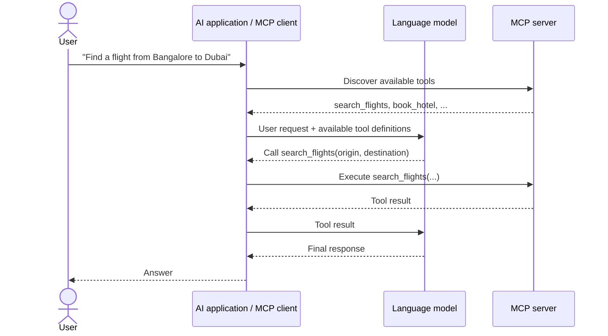

# MCP Practical Guide

Learn how [Model Context Protocol (MCP)](https://modelcontextprotocol.io/) connects an AI application to tools and other capabilities exposed by a server. This repository contains small Python examples for local **STDIO** communication, **Streamable HTTP**, and a **LangChain** agent.

> [!NOTE]
> These are learning examples, not production travel software. Flight, hotel, and weather responses are hard-coded demo data; no real search or booking takes place.

## Contents

- [MCP in a minute](#mcp-in-a-minute)
- [How a tool call works](#how-a-tool-call-works)
- [Transports: STDIO and Streamable HTTP](#transports-stdio-and-streamable-http)
- [Repository examples](#repository-examples)
- [Setup](#setup)
- [Run the examples](#run-the-examples)
- [Troubleshooting](#troubleshooting)

## MCP in a minute

MCP is a standard way for an AI application to discover and use capabilities provided by another program. The application connects through an **MCP client** to an **MCP server**. The server can expose:

| Capability | What it provides | Example in this repository |
| --- | --- | --- |
| **Tools** | Actions the model can request the application to run | `search_flights`, `book_hotel`, `add` |
| **Resources** | Data the application can read | `travel://preferences`, `weather://{city}` |
| **Prompts** | Reusable prompt templates | `plan_vacation` |

An MCP server is a program providing capabilities, not necessarily a separate machine. A client and server can run on the same computer.

## How a tool call works

The model chooses a tool based on the user's request, but the MCP client is responsible for calling the server and returning its result to the model.



<details>
<summary><strong>What happens in the manual OpenAI example?</strong></summary>

The client discovers MCP tools, converts their schemas to OpenAI function tools, sends the user's question to the model, executes any requested MCP tool, and sends the tool result back to the model for a final response. The client code demonstrates this orchestration explicitly.

</details>

## Transports: STDIO and Streamable HTTP

The transport answers: **how does the MCP client communicate with the server?**

| Transport | Best suited to | How this repository uses it |
| --- | --- | --- |
| **STDIO** | A local server process launched by the client | `MCP_LangChain` launches its server as a subprocess |
| **Streamable HTTP** | A server reached over a network | `MCP_HTTPS` connects to a server at `http://127.0.0.1:8000/mcp` |

With STDIO, the client and server exchange protocol messages over standard input and output pipes; no network connection is required. With HTTP, they communicate over a network. **HTTPS** is HTTP secured with TLS.

> [!IMPORTANT]
> Despite its directory name, `MCP_HTTPS` runs **plain local HTTP**, not HTTPS: its server starts Streamable HTTP on port `8000`, and its client connects to `http://127.0.0.1:8000/mcp`. Do not expose this demo server to an untrusted network as-is.

## Repository examples

| Path | What it demonstrates | Current state |
| --- | --- | --- |
| [`MCP/`](MCP/) | Manual OpenAI tool-calling flow over STDIO | Starter example. The server is a scaffold, and does not yet implement the `search_flights` tool expected by the client. |
| [`MCP_HTTPS/`](MCP_HTTPS/) | FastMCP server and client using Streamable HTTP | Runnable local demo; the client lists and calls `search_flights`. |
| [`MCP_LangChain/`](MCP_LangChain/) | FastMCP server over STDIO, connected to a LangChain agent | Runnable demo; the adapter supplies MCP tools to the agent. |
| [`mcp_practical_guide.md`](mcp_practical_guide.md) | Additional notes and diagrams about MCP concepts and transports | Companion learning notes. |
| [`MCP_Guide.pdf`](MCP_Guide.pdf) | PDF guide | Reference material. |

### Tools, resources, and prompts in the demos

The FastMCP servers in `MCP_HTTPS/` and `MCP_LangChain/` expose:

- `add(a, b)` — adds two integers.
- `search_flights(origin, destination)` — returns a sample flight response.
- `book_hotel(city, nights)` — returns a sample booking response; it does not book a real hotel.
- `travel://preferences` — returns sample travel preferences.
- `weather://{city}` — returns sample weather information.
- `plan_vacation(destination, days)` — returns a vacation-planning prompt.

The HTTP and STDIO examples use different demo response text. Neither connects to a travel provider or performs a real transaction.

## Setup

Use Python and a virtual environment from the repository root.

### Windows PowerShell

```powershell
python -m venv .venv
.\.venv\Scripts\Activate.ps1
python -m pip install --upgrade pip
pip install -r requirements.txt
```

If PowerShell blocks virtual-environment activation, use the environment's interpreter directly, for example:

```powershell
.\.venv\Scripts\python.exe -m pip install -r requirements.txt
```

### macOS / Linux

```bash
python3 -m venv .venv
source .venv/bin/activate
python -m pip install --upgrade pip
pip install -r requirements.txt
```

The OpenAI-backed examples (`MCP/client.py` and `MCP_LangChain/client.py`) also require an OpenAI API key in the `OPENAI_API_KEY` environment variable. Set it in your shell or operating-system environment; do not commit API keys.

<details>
<summary><strong>Set the key for the current terminal</strong></summary>

PowerShell:

```powershell
$env:OPENAI_API_KEY = "your-api-key"
```

macOS / Linux:

```bash
export OPENAI_API_KEY="your-api-key"
```

</details>

## Run the examples

Run the commands below from the repository root. Keep the server terminal open while running its client when using HTTP.

### 1. Streamable HTTP demo

**Terminal 1 — start the server:**

```powershell
cd MCP_HTTPS
python server.py
```

**Terminal 2 — call the server:**

```powershell
cd MCP_HTTPS
python client.py
```

The client connects to `http://127.0.0.1:8000/mcp`, lists available tools, and calls `search_flights`. No OpenAI API key is needed for this client-server demo.

### 2. LangChain agent over STDIO

Set `OPENAI_API_KEY`, then run:

```powershell
cd MCP_LangChain
python client.py
```

The client launches `server.py` over STDIO, discovers its tools through the LangChain MCP adapter, and asks the configured OpenAI model to answer a sample flight request. The model name is set in the client code; change it to a model available to your API account if needed.

### 3. Manual OpenAI + MCP client

`MCP/client.py` illustrates the manual tool-calling loop, but it is not ready to run end-to-end with the current `MCP/server.py`: the server is a scaffold and does not implement `search_flights`. Complete the server and tool implementation before trying this example. The client also needs `OPENAI_API_KEY`.

## Troubleshooting

<details>
<summary><strong>Connection refused when running the HTTP client</strong></summary>

Start `MCP_HTTPS/server.py` first and leave it running. Confirm the client URL is `http://127.0.0.1:8000/mcp` and that port `8000` is available.

</details>

<details>
<summary><strong>Missing OpenAI API key</strong></summary>

Set `OPENAI_API_KEY` in the same terminal or environment used to launch the OpenAI-backed client. The HTTP client does not call OpenAI and does not need this key.

</details>

<details>
<summary><strong>Module not found</strong></summary>

Activate the virtual environment used during setup, or run the commands with its Python interpreter. Install the declared dependencies with `pip install -r requirements.txt`.

</details>

## Further reading

- [Official MCP documentation](https://modelcontextprotocol.io/)
- [MCP Python SDK](https://github.com/modelcontextprotocol/python-sdk)
- [LangChain MCP adapters](https://github.com/langchain-ai/langchain-mcp-adapters)
